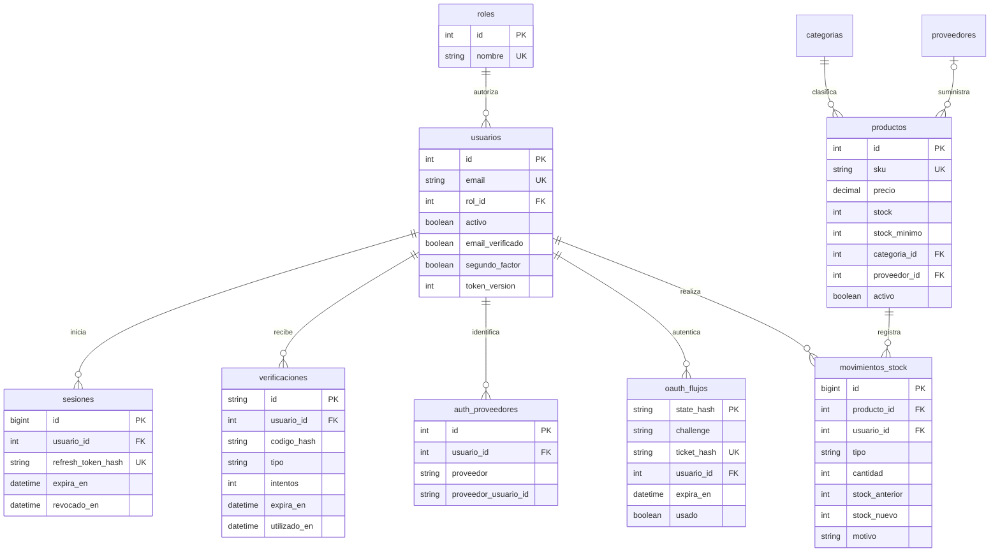

# Arquitectura de StockFlow

## Componentes

El frontend Expo vive en `mobile`. Las rutas viven en `mobile/src/app`. Expo Router organiza pantallas públicas, pestañas y módulos secundarios. `AuthContext` conserva usuario, carga inicial, errores y desafío de segundo factor. `session.ts` implementa Axios sin depender de React Native, para poder probarlo con un servidor HTTP real. `api.ts` conecta almacenamiento: SecureStore en Android y memoria en web.

Los componentes `Page`, `Card`, `Input`, `Button`, `Sheet`, `Confirm`, `Status`, `Pager` y `EntityForm` comparten estilo, accesibilidad y estados. React Hook Form controla formularios. Los listados usan paginación del servidor y recarga al recuperar foco. La interfaz consume datos de MySQL a través de la API; no mantiene catálogos simulados.

El backend Express conserva capas de rutas, middleware, validadores, servicios y repositorio de inventario. Las rutas interpretan HTTP; Zod limita entradas; los servicios aplican reglas; mysql2 ejecuta SQL parametrizado. Los nombres dinámicos de tablas/columnas provienen de listas internas, nunca del usuario.

## Flujo de acceso

1. Registro valida email y contraseña, aplica bcrypt y crea rol empleado dentro de una transacción junto con la sesión.
2. Access JWT HS256 dura 15 minutos; refresh dura 7 días. Ambos verifican emisor y audiencia. El refresh se almacena únicamente como SHA-256.
3. El usuario sin correo verificado puede gestionar su autenticación y perfil, pero no acceder al inventario.
4. Al renovar, MySQL bloquea el usuario y la sesión. El refresh anterior se revoca y nace otro; reutilizar el anterior revoca todos los refresh activos de esa cuenta.
5. Axios comparte una promesa de renovación. Un 401 tardío del token anterior reutiliza el token ya renovado. Solo reintenta cada solicitud una vez.
6. Un error de conexión conserva credenciales para reintentar; un rechazo definitivo de renovación borra la sesión. Logout borra primero el almacenamiento local y después intenta revocación remota.
7. Un cambio de rol/estado, contraseña o configuración 2FA incrementa `token_version`: los access anteriores fallan inmediatamente. Logout ordinario no incrementa esa versión, por lo que un access ya emitido puede durar hasta 15 minutos.

El rol y el estado activo se consultan en MySQL en cada solicitud. Ocultar botones es una ayuda visual; la seguridad está en el backend.

## Códigos de correo

Cada desafío usa UUID y código aleatorio de 6 dígitos. Se guarda HMAC-SHA256 del UUID y código usando un secreto del servidor. El HMAC impide probar todos los códigos offline con solo una copia de la tabla. No se imprimen códigos en logs ni se devuelven por API.

Vencen en 10 minutos, admiten cinco errores y se consumen una vez. Se bloquean usuario y desafío para serializar intentos. El contador de fallos se confirma aunque la respuesta sea 401. Hay enfriamiento de 60 segundos por usuario y tipo, más rate limiting por IP. Enviar otro código invalida los anteriores del mismo tipo.

Nodemailer envía a SMTP; producción exige TLS. El código existe transitoriamente en memoria y en el correo destinado al usuario, pero no se persiste en texto plano en MySQL. Las pruebas capturan mensajes solo en memoria de un SMTP local.

## OAuth

Se utiliza navegador del sistema con callback HTTPS al backend. El backend crea `state` aleatorio, lo guarda como hash, canjea el código con el secreto y obtiene la identidad desde el proveedor. Google usa UserInfo de OIDC y `sub`; GitHub usa ID de usuario y email verificado; Facebook usa ID y requiere verificación local de correo al no asumir que email sea verificado.

El callback redirige a `stockflow://oauth` con un ticket efímero, nunca JWT ni token del proveedor. La app canjea el ticket con un verificador cuya huella SHA-256 envió al iniciar el flujo. Esta prueba de posesión protege el ticket ante interceptación del deep link. `state` protege la solicitud al proveedor. Ticket: 60 segundos y un solo uso; inicio OAuth: 5 minutos.

La relación se identifica por `(proveedor, proveedor_usuario_id)`. Una coincidencia de email con otra cuenta se rechaza; no hay vinculación automática ni pantalla para vincular cuentas distintas en esta versión. Se debe continuar usando el método original. Si se activa segundo factor, tampoco OAuth lo evita.

## Inventario y administración

`SELECT ... FOR UPDATE` bloquea el producto durante el movimiento. Se calcula el stock nuevo, se comprueban límites y se guardan producto e historial en la misma transacción. Una falla de auditoría revierte ambas operaciones. No hay DELETE de movimientos.

La baja es lógica. Se exige stock cero y no se desactivan referencias que todavía tienen productos activos. Un candado `admin_lock` serializa cambios de permisos y vuelve a comprobar al administrador dentro de la transacción; se bloquea la autoexclusión y se conserva al menos un administrador activo.

## Modelo entidad-relación

## Límites operativos

Aplicación de un comercio, sin multiempresa. Rate limit en memoria: para varias réplicas requiere almacén compartido. Debe configurarse proxy/HTTPS y respaldos antes de producción. Las tablas de códigos/sesiones y flujos OAuth necesitan una política de limpieza de registros expirados, conservando el tiempo de detección de reutilización acordado. No se probó carga productiva.
