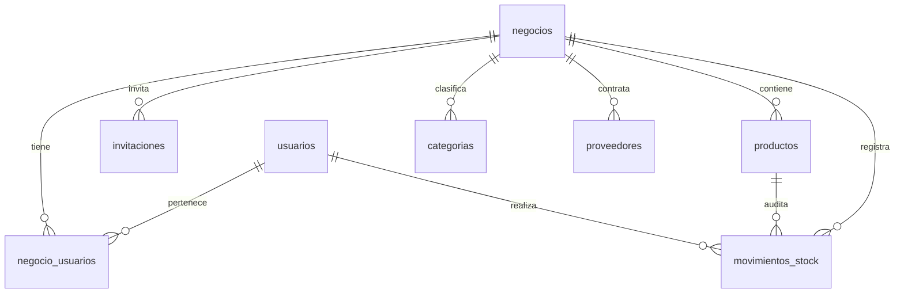

# StockFlow multinegocio — 16/10/2026

## Auditoría y decisión de migración

El esquema anterior tenía usuarios con `rol_id` global, nombres/SKU globalmente únicos y cuatro tablas de inventario sin negocio. Las rutas `/users` permitían administrar identidades globales. La app tomaba permisos de `user.rol` y entraba al dashboard después del login.

La migración 005 crea negocios, membresías e invitaciones. Asigna todas las filas anteriores a un negocio histórico **inactivo, sin creador ni integrantes**. No cambia IDs, stock, precios, autores ni fechas. Se conserva `usuarios.rol_id` únicamente como dato histórico/compatibilidad de esquema; ningún permiso de negocio se obtiene de esa columna. Las rutas globales de administración se reemplazaron por administración de membresías. La cuenta personal solo se edita mediante `/auth/me`.

En la instalación local se verificaron antes y después **3 cuentas, 2 productos y 1 movimiento**. Se guardó un dump previo en `.local-backups/pre-businesses-XXXXXX.sql`, excluido de Git y con permisos restringidos. No restaurarlo sobre una base que haya recibido nuevas operaciones sin evaluar antes cómo conservarlas.

Los registros históricos no se adjudican desde la app. Si se desea recuperarlos, debe identificarse explícitamente al propietario autorizado. Un operador puede asignar una membresía admin verificada al negocio histórico y activarlo en una transacción, comprobando que no haya integrantes previos. Esa asignación no se ejecutó automáticamente.

## Modelo y permisos

`negocio_usuarios` tiene ID, negocio, usuario, rol, estado y fecha de incorporación; la pareja negocio/usuario es única. Los tres roles conservan sus permisos de inventario, pero solo en su negocio. Siempre debe existir al menos un administrador activo de un negocio activo. La creación de negocio y su primera membresía es una sola transacción.

Las rutas de inventario, dashboard, reportes y demo exigen JWT, email verificado y `X-Business-Id`. El middleware lee la membresía actual. Cada consulta filtra por negocio; los IDs ajenos no dan acceso. Nombres de categorías/proveedores y SKU son únicos por negocio, incluidos registros dados de baja. Las referencias SQL compuestas garantizan que producto/categoría/proveedor/movimiento pertenezcan al mismo negocio.

Cada escritura bloquea primero el negocio y vuelve a comprobar la membresía dentro de la transacción, luego bloquea los recursos afectados. Así la revocación de un integrante, los cambios de admin y los movimientos simultáneos tienen un orden definido. Se serializan las escrituras de un mismo negocio; es una decisión conservadora para este proyecto escolar. Otros negocios pueden trabajar en paralelo. No se probó carga productiva.

## Invitaciones

Se envía email con nombre del negocio, rol y enlace `/invite#token=...`. El token tiene 32 bytes aleatorios y solo se persiste SHA-256. Expira a los siete días. Los estados son pendiente, aceptada y cancelada; vencida se calcula según la fecha. Reenvío rota el token y espera al menos un minuto; no permite reutilizar el anterior.

La bandeja autenticada lista únicamente invitaciones al email verificado del usuario. Se puede aceptar mediante token o ID de esa bandeja, siempre comprobando nuevamente email, usuario activo, negocio activo, estado y vencimiento. Un ID público no concede permiso. Aceptación y membresía se confirman juntas bajo bloqueo, evitando doble aceptación.

El SMTP usa las mismas variables de verificación de cuenta. Si falla el envío inicial, la invitación queda pendiente con envío sin confirmar, para reenviar desde Equipo. No se expone el token en respuesta, SQL ni logs. Las pruebas usan un servidor SMTP local que captura solo mensajes de prueba en memoria. En producción configurar `WEB_APP_URL` con el origen HTTPS accesible a los destinatarios; localhost solo sirve para probar en la misma computadora. En Android el destinatario también puede iniciar sesión y aceptar desde Tus negocios, aunque abra el correo en otro dispositivo.

## Navegación y sesión

Sin negocios se ofrece crear uno o aceptar invitaciones. Con uno se selecciona automáticamente al iniciar sesión; con varios se elige. Inicio y Perfil ofrecen cambiar de negocio. Mi negocio muestra información y configuración; Equipo contiene integrantes, invitación, reenvío y cancelación.

`BusinessContext` mantiene la selección separada de `AuthContext`. Cambiar negocio no modifica JWT ni contraseña. Las rutas de inventario están protegidas por una selección autorizada. El cambio elimina pantallas anteriores del historial, reinicia los recursos y usa una generación de solicitudes para rechazar respuestas tardías y reintentos de escrituras del negocio anterior. Un cambio de cuenta borra la selección; la lista siempre se vuelve a consultar al servidor.

## Comprobaciones

- Backend: 25 pruebas de integración (22 escenarios y 3 contenedoras) contra MySQL y SMTP locales; 3 pruebas unitarias JWT/validación.
- Aislamiento: listado/detalle/edición/baja ajenos, referencias categoría/proveedor, SKU repetido entre negocios, reportes y movimientos.
- Invitaciones: envío, email incorrecto, no verificado, vencimiento, reenvío/cancelación, doble aceptación simultánea y bandeja propia.
- Permisos: admin de A/empleado de B, baja local con JWT todavía válido, último admin concurrente, desactivación con stock e historial conservado.
- Inventario: salidas concurrentes y rollback real cuando falla insertar la auditoría.
- Móvil: pruebas de sesión y descarte de respuesta/reintento después de cambiar contexto.
- E2E web: crear negocio, CRUD y movimiento, reporte, invitación SMTP, segunda cuenta que acepta como empleado, segundo negocio vacío y retorno al inventario original.

Comandos desde la raíz: `npm run typecheck`, `npm test`, `npm run test:integration`. Desde mobile: `npm run lint`, `npm run test:e2e` (Metro con API de prueba 3001), `npm run test:oauth:web`, `npm run export:android`.

## Entrega externa pendiente

El correo de registro real fue confirmado por el usuario; las nuevas invitaciones se validaron con SMTP local. Falta probar entrega de invitaciones real al destinatario elegido. OAuth y MFA se conservan, con regresiones automatizadas; el consentimiento social real de cada cuenta continúa pendiente. Aiven requiere completar validación del certificado CA, Render no está desplegado y no se ha generado un APK ni realizado prueba Android física. EAS requiere asociar proyecto y URL HTTPS real. Ninguna de esas dependencias bloquea el flujo multinegocio local.
